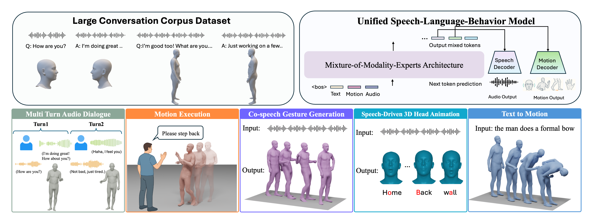

# ViBES

[](https://arxiv.org/pdf/2512.14234)
[](https://ai.stanford.edu/~juze/ViBES/)
[](https://huggingface.co/JuzeZhang/ViBES-Face)

This repository contains the official implementation of "ViBES: A Conversational Agent with Behaviorally-Intelligent 3D Virtual Body".

## 🔍 Overview

ViBES is a speech-language-behavior (SLB) model with a mixture-of-modality-experts (MoME) architecture that ingests audio, motion, or text and shares cross-modal information via speech-language-behavior Attention (SLB-Attn).



### Model variants

The speech models come in two sizes that differ only in the frozen speech/text backbone (Expert-0); the motion-expert design is the same. The same motion-expert design on a frozen text-only LLM gives a text-to-motion model:

| Variant | Frozen backbone (Expert-0) | Notes |
|---|---|---|
| **ViBES (9B)** | [GLM-4-Voice-9B](https://huggingface.co/THUDM/glm-4-voice-9b) | speech + face/body, best quality |
| **ViBES (0.5B)** | [ViBES-Audio](https://huggingface.co/JuzeZhang/ViBES-Audio) — our distilled 0.5B GLM-4-Voice | ~15× smaller backbone, low-latency / on-device. Face expert released (`ViBES-Face-0.5B`, on par with the 9B face on TFHP); body experts can be trained with [docs/2-training.md](docs/2-training.md#05b-variant-vibes-audio-backbone) |
| **ViBES-T2M (Qwen-MoME)** | [Qwen3-1.7B](https://huggingface.co/Qwen/Qwen3-1.7B) (text only) | text-to-motion on HumanML3D (R@1 0.486, FID 0.265); [`qwen_mome/`](qwen_mome/README.md) |

### Released checkpoints

Each checkpoint holds only the trained motion expert (Expert-1); the frozen backbone is rebuilt from its base model at load time.

| Checkpoint | What it does | Backbone | Download |
|---|---|---|---|
| `ViBES-Face` | conversation → speech + facial expressions | GLM-4-Voice-9B | [Hugging Face](https://huggingface.co/JuzeZhang/ViBES-Face) |
| `ViBES-Face-0.5B` | the same, on the 0.5B backbone (`--vibes_config vibes_0.5b`) | ViBES-Audio (0.5B) | [Google Drive](https://drive.google.com/drive/folders/17yH0Olqi3C5y5GpXuyg5rOZKQN027qeL) |
| `ViBES-Body-Cospeech` | body gestures for the generated speech, or for a speech clip (`--audio`) | GLM-4-Voice-9B | [Google Drive](https://drive.google.com/drive/folders/1GsoWZMcZYq-_IOYuKaWWu3bBZClV3E17) |
| `ViBES-Body-Agent` | body that also performs requested motions (`--agent`) | GLM-4-Voice-9B | [Google Drive](https://drive.google.com/drive/folders/1EiN7n2anqbHaKXRj28bOZzIC955qrhhH) |
| `ViBES-T2M` | text-to-motion (HumanML3D) | Qwen3-1.7B | [Hugging Face](https://huggingface.co/JuzeZhang/ViBES-T2M) |
| `ViBES-Face-TFHP-Eval` | face with a style prompt, for the paper's TFHP numbers (Table 4) | GLM-4-Voice-9B | [Google Drive](https://drive.google.com/drive/folders/1U5H0hAADrp9r73Er5G4AQrAFZXZBMuGL) |
| `ViBES-BEAT2-Speaker2-Eval` | BEAT2 speaker-2 gestures on EMAGE's VQ, for the paper's BEAT2 numbers (Table 5) | GLM-4-Voice-9B | [Google Drive](https://drive.google.com/drive/folders/1EHUJ2rIUvxlxRK8Sq36FKjV853hiHeBJ) |
| Stage-1 checkpoints | motion VQ-VAE tokenizers, Global VAE (body root translation), Q2M evaluator (Table 2) | — | [Google Drive](https://drive.google.com/drive/folders/1pASh6gc6skACDzLKfO8VllAUsZffXCFv), goes to `model_files/pretrained_cpt/` |

Inference: [docs/3-inference.md](docs/3-inference.md). Evaluation: [docs/4-evaluation.md](docs/4-evaluation.md).


## ✅ TODO List

- [x] Initial code release
- [x] Inference code for conversational behavior of facial expressions
- [x] Inference code for conversational behavior of body — `inference/inference_body.py` (upper+hands+lower via compositional VQs; global translation reconstructed by the Global VAE from lower-body pose and may drift on long sequences). A GENMO-representation upgrade for stable translation is in progress; combined face+body inference: `inference/inference_face_body.py`.
- [x] Lightweight 0.5B face model — `ViBES-Face-0.5B` on the [ViBES-Audio](https://huggingface.co/JuzeZhang/ViBES-Audio) backbone ([docs/3-inference.md](docs/3-inference.md#05b-face-model))
- [x] Body checkpoints — co-speech (`ViBES-Body-Cospeech`) and agent (`ViBES-Body-Agent`, `--agent`), on Google Drive (links in [Environment Setup](#-environment-setup))
- [x] Text-to-motion (HumanML3D) — ViBES motion expert on a frozen Qwen3-1.7B, [`qwen_mome/`](qwen_mome/README.md), weights at [`JuzeZhang/ViBES-T2M`](https://huggingface.co/JuzeZhang/ViBES-T2M)
- [x] Training code for face expert
- [x] Training code for body expert
- [x] Evaluation code for the paper's benchmarks — [docs/4-evaluation.md](docs/4-evaluation.md): Q2M on Converse3D ([evaluation set](docs/1-data/converse3d_eval.md)), TFHP talking head (with `ViBES-Face-TFHP-Eval`), BEAT2 co-speech gestures (with `ViBES-BEAT2-Speaker2-Eval`)
- [x] Dataset release (facial part) — [`JuzeZhang/Converse3D`](https://huggingface.co/datasets/JuzeZhang/Converse3D) (tokenized face training set), [`JuzeZhang/YouTube_Talking`](https://huggingface.co/datasets/JuzeZhang/YouTube_Talking), [`JuzeZhang/WebTalk-Synthetic`](https://huggingface.co/datasets/JuzeZhang/WebTalk-Synthetic)
- [x] Dataset release (body part) — the motion can't be redistributed, so we release our AMASS questions/answers/speech (Google Drive) and the Embody3D clip list, plus the recipe to rebuild the released checkpoints' training sets from your own BEAT2 / AMASS / Embody3D: [docs/1-data/body_training_sets.md](docs/1-data/body_training_sets.md)
- [x] Dataset preprocessing — per-dataset guides and scripts in [docs/1-data/](docs/1-data/)


## 🛠️ Environment Setup

Requires Conda, an NVIDIA GPU with CUDA 12.8+ (`nvcc` on the path for building PyTorch3D), and GCC 9.0+. Follow the installation order.

<details>
<summary><b>Show full installation steps</b></summary>

```bash
git clone --recurse-submodules https://github.com/Juzezhang/ViBES.git
cd ViBES

# Create environment
conda create --name ViBES -y python=3.10
conda activate ViBES

# Install PyTorch 2.8 with CUDA 12.8 (FlashAttention has prebuilt wheels up to torch 2.8)
pip install torch==2.8.0 torchvision==0.23.0 torchaudio==2.8.0 --index-url https://download.pytorch.org/whl/cu128
pip install numpy==1.26.4

# Install dependencies
pip install -r requirements.txt

# PyTorch3D, built with GPU support for the GPU on this machine. Run it on a GPU machine:
# a CPU-only build fails later with "Not compiled with GPU support" at rasterize_meshes.
# To build for other GPUs, set e.g. TORCH_CUDA_ARCH_LIST="8.0;8.6;8.9;9.0".
FORCE_CUDA=1 pip install --no-build-isolation "git+https://github.com/facebookresearch/pytorch3d.git@stable"

# FlashAttention 2 (downloads a prebuilt wheel for torch 2.8; other torch versions compile for 1-2 h)
pip install flash-attn==2.8.3.post2 --no-build-isolation

# Install Chumpy and apply patch
pip install "chumpy==0.70" --no-build-isolation
chmod +x ./scripts/patch_chumpy_numpy2.sh
./scripts/patch_chumpy_numpy2.sh

# Download GLM-4-Voice components (cosyvoice, speech tokenizer, decoder; needs git-lfs)
./scripts/download_glm4voice_modules.sh

# Download the GLM-4-Voice base model (provides the frozen text/audio expert; ~18 GB)
huggingface-cli download THUDM/glm-4-voice-9b --local-dir ./model_files/glm-4-voice-9b

# SMPL-X / FLAME body models and the face tokenizer. Asks for the account you registered on
# https://smpl-x.is.tue.mpg.de and https://flame.is.tue.mpg.de (use the same login for both)
./scripts/build_resources.sh

# Stage-1 checkpoints: motion tokenizers, Global VAE, Q2M evaluator (~2.5 GB)
gdown --folder https://drive.google.com/drive/folders/1pASh6gc6skACDzLKfO8VllAUsZffXCFv -O ./model_files/pretrained_cpt

# Our pretrained face model
# (motion expert only, ~0.86 GB; the frozen text/audio expert is reconstructed from the GLM base at load)
huggingface-cli download JuzeZhang/ViBES-Face --local-dir ./ViBES-Face

# The body experts (co-speech + agent, motion expert only, ~0.86 GB each)
gdown --folder https://drive.google.com/drive/folders/1GsoWZMcZYq-_IOYuKaWWu3bBZClV3E17 -O ./ViBES-Body-Cospeech
gdown --folder https://drive.google.com/drive/folders/1EiN7n2anqbHaKXRj28bOZzIC955qrhhH -O ./ViBES-Body-Agent
```

The body experts are on Google Drive for now; a Hugging Face mirror will follow. Every released
checkpoint, including the 0.5B face model and the evaluation checkpoints, is listed under
[Released checkpoints](#released-checkpoints).


</details>


## 🚀 Quick Start

<details open>
<summary><b>Conversation with text input — speech, face and co-speech body</b></summary>

```bash
python inference/inference_face_body.py \
    --checkpoint_face ./ViBES-Face \
    --checkpoint_body ./ViBES-Body-Cospeech \
    --glm_base_path ./model_files/glm-4-voice-9b \
    --user_text "If you had a superpower for one day, what would you choose?" \
    --output_dir ./results/face_body --front_view
```

The face expert answers with speech and facial expressions. The co-speech body expert then generates
gestures for that speech, so body, face and audio stay in sync. Both checkpoints ship the trained
**motion expert only**: the frozen text/audio expert is rebuilt from the GLM-4-Voice base given by
`--glm_base_path` (default `THUDM/glm-4-voice-9b`, auto-downloaded to the HF cache). The two models are
loaded one after the other, so only one 9B model is on the GPU at a time.

Outputs in `--output_dir`: `<prefix>.mp4` (SMPL-X render with the speech), `<prefix>.npz` (SMPL-X
`poses` / `expressions` / `trans`, 25 fps) and `<prefix>.wav`. Face-only, body-only, audio-driven and
agent (`--agent`) runs are covered in [docs/3-inference.md](docs/3-inference.md).

Demo output

https://github.com/user-attachments/assets/2ecc0816-e0cb-462c-9dcf-e3a6001ad429

*Example output of the command above: speech, face and co-speech body (hands included), rendered in Blender*

</details>


## 📚 Documentation

Full guides live under [`docs/`](docs/index.md):

| Topic | Link |
|---|---|
| Project overview | [docs/0-overview.md](docs/0-overview.md) |
| Dataset preprocessing | [docs/1-data/](docs/1-data/) |
| Training (tokenizers + LLM expert) | [docs/2-training.md](docs/2-training.md) |
| Inference & utilities | [docs/3-inference.md](docs/3-inference.md) |
| Evaluation (how to reproduce the paper's tables) | [docs/4-evaluation.md](docs/4-evaluation.md) |


## Acknowledgements

<details>
<summary><b>Projects we build on</b></summary>

We thank the following projects for sharing their great work.
- **GLM-4-Voice**: https://github.com/zai-org/GLM-4-Voice
- **Language of Motion**: https://github.com/Juzezhang/language_of_motion
- **ARTalk**: https://github.com/xg-chu/ARTalk/tree/main
- **FLAME**: https://flame.is.tue.mpg.de
- **EMICA**: https://github.com/radekd91/inferno

</details>


## 📖 Citation

If you find our work useful in your research, please consider citing:

<details open>
<summary><b>BibTeX</b></summary>

```bibtex
@inproceedings{
      zhang2026vibes,
        title={ViBES: A Conversational Agent with Behaviorally-Intelligent 3D Virtual Body},
      author={Juze Zhang and Changan Chen and Xin Chen and Heng Yu and Tiange Xiang and Ali Sartaz Khan and Shrinidhi Kowshika Lakshmikanth and Ehsan Adeli},
      booktitle={CVPR},
      year={2026},
}
```

</details>
